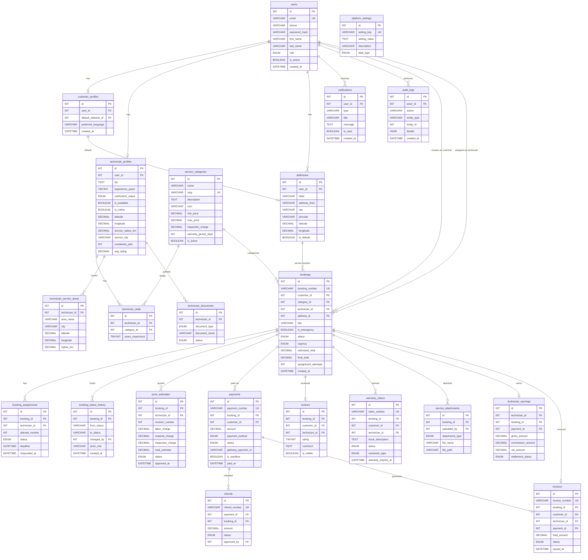

# FixAround — Entity Relationship Diagram

## Table Relationship Summary

| Parent | Child | Relationship | FK Rule |
|--------|-------|-------------|---------|
| users | customer_profiles | 1:1 | CASCADE |
| users | technician_profiles | 1:1 | CASCADE |
| users | addresses | 1:N | CASCADE |
| users | bookings (customer) | 1:N | RESTRICT |
| users | bookings (technician) | 1:N | SET NULL |
| users | notifications | 1:N | CASCADE |
| service_categories | bookings | 1:N | RESTRICT |
| service_categories | technician_skills | 1:N | CASCADE |
| technician_profiles | technician_skills | 1:N | CASCADE |
| technician_profiles | technician_service_areas | 1:N | CASCADE |
| technician_profiles | technician_documents | 1:N | CASCADE |
| bookings | booking_assignments | 1:N | CASCADE |
| bookings | booking_status_history | 1:N | CASCADE |
| bookings | price_estimates | 1:N | CASCADE |
| bookings | payments | 1:N | RESTRICT |
| bookings | invoices | 1:1 | RESTRICT |
| bookings | reviews | 1:1 | RESTRICT |
| bookings | warranty_claims | 1:N | RESTRICT |
| bookings | service_attachments | 1:N | CASCADE |
| bookings | technician_earnings | 1:1 | RESTRICT |
| payments | refunds | 1:N | RESTRICT |
| payments | invoices | 1:1 | SET NULL |
